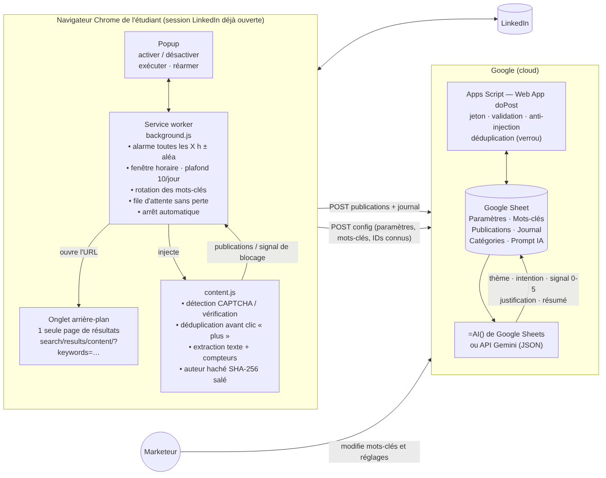
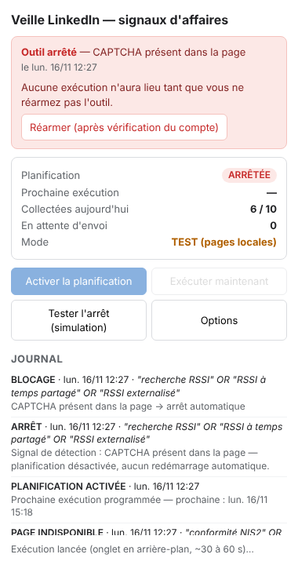

# Veille LinkedIn automatisée — signaux d'affaires pour une offre d'audit de cybersécurité

Exercice 1 du cours de marketing automation / growth hacking 2026.
L'outil cherche chaque jour, par mots-clés, des publications LinkedIn qui peuvent révéler un besoin d'**audit de cybersécurité** (incident subi, échéance NIS2, recherche de prestataire…). Il les range dans une **Google Sheet**, et un LLM les classe.

> **Avertissement.** Automatiser LinkedIn viole ses conditions d'utilisation. Le compte utilisé peut être restreint, suspendu ou banni. L'outil n'utilise que **votre propre session**, il collecte le moins possible et **s'arrête au premier signal de détection**. Aucune fréquence n'est « indétectable ». L'exercice est optionnel.

---

## 1. Ce que fait l'outil (correspondance avec le cahier des charges)

| Exigence | Implémentation |
|---|---|
| URL `search/results/content/?keywords=…` correctement encodée | `construireUrlRecherche()` dans `extension/lib.js` (`%22mission%20de%20conseil%22`, testé) |
| Tri par date + période récente | `sortBy=%22date_posted%22` et `datePosted=%22past-24h%22`, réglables dans la Sheet (`TRI`, `PERIODE`) |
| Une seule page ouverte, aucune autre navigation | un onglet en arrière-plan, **un seul chargement** par exécution, fermé à la fin |
| Session de l'étudiant, dans son navigateur | extension Chrome : pas de mot de passe, pas de cookie copié |
| Clic sur « plus » pour le texte complet | uniquement pour les publications **nouvelles** (la déduplication passe avant le clic), option `CLIQUER_PLUS` |
| URL/ID, date relative telle quelle, date de collecte, auteur haché, texte, réactions/commentaires/republications | `content.js` → onglet **Publications** |
| Pas de photo, d'image ni de vidéo | seul le texte est lu ; les médias sont ignorés |
| Jamais deux fois la même publication | IDs connus côté extension **et** contrôle côté Apps Script (sous verrou) |
| 10 par jour au maximum, 3 ou 4 par exécution, pauses variables | `MAX_PAR_JOUR` (plafond absolu de 10 dans le code), tirage au hasard entre 3 et 4, pauses de 2 à 6 s |
| Erreurs : session expirée, page indisponible, résultats vides | journalisées ; file d'attente locale → **aucune perte** si la Sheet est injoignable |
| Arrêt automatique en cas de CAPTCHA/avertissement/vérification | arrêt + journal + badge STOP, **pas de relance automatique** ; démontré (§ 9) |
| Planification activable/désactivable, toutes les X h ± aléa, fenêtre horaire | popup de l'extension + `chrome.alarms` ; `INTERVALLE_HEURES`, `ALEA_MINUTES`, `FENETRE_DEBUT/FIN` |
| Journal d'exécution | popup + onglet **Journal** (date, mots-clés, nombre collecté, erreurs, arrêts, prochaine échéance) |
| Paramétrable par un marketeur sans compétences techniques | tout se règle dans la Google Sheet (onglets **Paramètres** et **Mots-clés**) |
| Classification LLM structurée | `=AI()` de Google Sheets (ou API Gemini avec schéma JSON) : thème, intention, signal 0–5 + justification, résumé |

## 2. Architecture



- **Extension Chrome (Manifest V3)** : tourne dans votre navigateur, avec votre session LinkedIn.
  - `background.js` (service worker) planifie, orchestre, applique les plafonds, met en file d'attente, arrête.
  - `content.js` est injecté dans l'onglet de résultats : il détecte les blocages, extrait et pseudonymise.
  - `lib.js` contient les fonctions pures (URL, fenêtre horaire, échéances, quotas), testées.
- **Google Apps Script** (`apps-script/Code.gs`) déployé en *Application Web* : il reçoit les données (POST + jeton), dédoublonne, neutralise les formules et pose la classification.
- **Google Sheet** : réglages, mots-clés, publications, journal, catégories et prompt du LLM.

Pourquoi une extension plutôt que Playwright ou Python : elle utilise la vraie session de l'étudiant sans exporter de cookie. Elle n'ajoute aucun navigateur piloté (pas de signature « headless »). Elle s'installe sans Python, et sa planification (`chrome.alarms`) se coupe d'un clic.

## 3. Contenu du dossier

```
veille-linkedin/
├── extension/               ← à charger dans Chrome (« Charger l'extension non empaquetée »)
│   ├── manifest.json
│   ├── background.js        planification, orchestration, arrêt, file d'attente
│   ├── content.js           détection de blocage + extraction (injecté dans la page de résultats)
│   ├── lib.js               fonctions pures testées
│   ├── popup.html/.js       activer / désactiver, exécuter, réarmer, journal
│   ├── options.html/.js     URL du webhook + jeton (stockés localement)
│   └── test/                pages factices + page de simulation de blocage
├── apps-script/
│   ├── Code.gs              à coller dans Extensions › Apps Script de la Sheet
│   └── appsscript.json
├── docs/                    schéma d'architecture, captures
├── tests/                   tests unitaires + test de bout en bout (sans LinkedIn)
└── README.md
```

## 4. Installation (≈ 15 minutes)

### A. Google Sheet + Apps Script

1. Créez une Google Sheet vide (par exemple « Veille LinkedIn — audit cyber »).
2. **Extensions › Apps Script**. Remplacez le contenu de `Code.gs` par celui de `apps-script/Code.gs`, puis enregistrez.
3. Dans l'éditeur, sélectionnez la fonction `initialiser` et cliquez sur **Exécuter**. Acceptez les autorisations (accès à cette Sheet uniquement).
   Les onglets *Publications, Paramètres, Mots-clés, Journal, Catégories, Prompt IA* sont créés, et un **jeton d'accès** s'affiche (rouvrez la Sheet pour voir le menu **Veille LinkedIn**).
4. **Déployer › Nouveau déploiement › Type : Application Web**
   - *Exécuter en tant que* : **Moi**
   - *Qui a accès* : **Tout le monde** (le jeton protège l'accès)
   - Copiez l'URL qui se termine par **`/exec`**.

### B. Extension Chrome

1. Ouvrez `chrome://extensions`, activez le **Mode développeur**, puis cliquez sur **Charger l'extension non empaquetée** et choisissez le dossier `extension/`.
2. Épinglez l'icône de l'extension. Dans **Options**, collez l'URL `/exec` et le jeton (menu *Veille LinkedIn › Afficher le jeton d'accès*).
3. Cliquez sur **Tester la connexion à la Sheet**. Vous devez voir : « Connexion OK : 10 mot(s)-clé(s) actif(s) ».
4. Connectez-vous normalement à LinkedIn dans ce même navigateur.

### C. Vérifier les paramètres de filtre (partie de l'exercice)

Sur LinkedIn, lancez une recherche, ouvrez l'onglet **Publications**, puis appliquez *Trier par : Plus récents* et *Date de publication : 24 dernières heures*. Lisez l'URL :

```
https://www.linkedin.com/search/results/content/?datePosted=%22past-24h%22&keywords=%22audit%20de%20s%C3%A9curit%C3%A9%22&origin=FACETED_SEARCH&sortBy=%22date_posted%22
```

Si LinkedIn a changé ces noms, adaptez `PERIODE`/`TRI` dans la Sheet ou `construireUrlRecherche()` dans `lib.js`. C'est la fragilité de ce type d'outil : rien de tout cela n'est documenté ni garanti.

## 5. Utilisation

- **Exécuter maintenant** (popup) : une exécution immédiate, hors fenêtre horaire comprise, mais toujours dans la limite du plafond journalier. Un onglet s'ouvre en arrière-plan pendant 30 à 60 s, puis se ferme.
- **Activer la planification** : la prochaine échéance s'affiche (popup + onglet Journal). Le badge **ON** apparaît.
- **Journal** : les 12 dernières entrées dans le popup, l'historique complet dans l'onglet **Journal**.
- **Classification** : les colonnes *Thème → Résumé* se remplissent toutes seules (formule `=AI()`).
- **Statut commercial** : une liste déroulante (À traiter / Contacté / En discussion / Non pertinent) sert au suivi commercial.

### Fin de séance (obligatoire)

1. Popup › **Désactiver la planification**. *Prochaine exécution* doit afficher « — » et le badge doit disparaître. L'entrée *PLANIFICATION DÉSACTIVÉE* est journalisée : c'est votre preuve.
2. Facultatif : désactivez l'extension dans `chrome://extensions`.
3. Côté Google, rien ne tourne : le script n'a **aucun déclencheur horaire**, il ne s'exécute que lorsqu'il est appelé.
4. Filet de sécurité : renseignez `FIN_PLANIFICATION` (par exemple `2026-11-16 17:30`). La planification s'éteindra seule même en cas d'oubli.

## 6. Paramétrage (onglets Paramètres et Mots-clés)

| Paramètre | Défaut | Rôle |
|---|---|---|
| `INTERVALLE_HEURES` | 3 | une exécution toutes les X heures (1–24) |
| `ALEA_MINUTES` | 20 | ± décalage aléatoire autour de chaque échéance |
| `FENETRE_DEBUT` / `FENETRE_FIN` | 09:00 / 19:00 | aucune exécution automatique hors de cette plage |
| `JOURS_ACTIFS` | 1,2,3,4,5 | du lundi au vendredi |
| `MAX_PAR_JOUR` | 10 | plafonné à 10 dans le code, quelle que soit la valeur saisie |
| `MAX_PAR_EXECUTION_MIN/MAX` | 3 / 4 | volume tiré au hasard à chaque exécution |
| `PERIODE` | past-24h | past-24h, past-week, past-month ou aucun |
| `TRI` | date_posted | date_posted ou relevance |
| `CLIQUER_PLUS` | OUI | déplie le texte des publications nouvelles uniquement |
| `PAUSE_MIN_SEC` / `PAUSE_MAX_SEC` | 2 / 6 | pause aléatoire entre deux actions |
| `FIN_PLANIFICATION` | (vide) | date et heure d'extinction automatique de la planification |
| `CLASSIFICATION` | AI | AI (`=AI()`), GEMINI (API, sortie JSON) ou AUCUNE |
| `MODELE_GEMINI` | gemini-2.5-flash | modèle utilisé si `CLASSIFICATION` = GEMINI |

**Mots-clés** : une ligne par requête. Cochez la case *Actif* et utilisez la syntaxe de la barre de recherche LinkedIn (guillemets pour une expression exacte, `OR` en majuscules). À chaque exécution, l'outil traite **une seule** requête : celle qui attend depuis le plus longtemps.

## 7. Mots-clés proposés (offre : audits de cybersécurité pour PME/ETI)

| Requête | Signal visé |
|---|---|
| `"audit de sécurité"` | besoin explicite |
| `"test d'intrusion" OR "pentest"` | besoin explicite |
| `"tentative de phishing" OR "victime de phishing"` | incident subi : le moment où le budget se débloque |
| `"rançongiciel" OR "ransomware"` | incident ou crainte |
| `"conformité NIS2" OR "directive NIS2"` | obligation réglementaire datée |
| `"recherche RSSI" OR "RSSI à temps partagé" OR "RSSI externalisé"` | compétences manquantes en interne |
| `"prestataire cybersécurité" OR "cabinet cybersécurité"` | recherche de prestataire (attention aux concurrents) |
| `"audit informatique"` | formulation typique des PME |
| `"migration Microsoft 365" OR "migration cloud"` | projet IT qui ouvre une fenêtre d'audit |
| `"cyberattaque" PME` | incident ou sensibilisation, à qualifier |

Ces requêtes sont un point de départ. Passez-les dans les deux prompts « Signaux d'affaires B2B » du cours, gardez les meilleures dans l'onglet **Mots-clés**, puis reportez-les dans la Google Sheet des exercices.

## 8. Classification par LLM

Chaque nouvelle ligne reçoit en colonne K une formule `=AI(prompt; texte)`. Le prompt est construit à partir de l'onglet **Prompt IA** (consignes modifiables) et de l'onglet **Catégories**. Le modèle répond sur une ligne au format `THEME: … | INTENTION: … | SIGNAL: n | JUSTIFICATION: … | RESUME: …`, que les colonnes L à P découpent avec `REGEXEXTRACT`. Modifier une catégorie dans l'onglet se répercute sur les lignes suivantes. Pour reclasser des lignes existantes : *Veille LinkedIn › Réappliquer =AI() aux lignes non classées*.

Si `=AI()` n'est pas disponible sur votre compte, ou pour une **sortie structurée garantie**, mettez `CLASSIFICATION = GEMINI` et enregistrez une clé API Google AI Studio (*Veille LinkedIn › Enregistrer la clé API Gemini*, stockée dans les Propriétés du script). L'appel utilise alors un `responseSchema` JSON : thème et intention restreints à la liste (enum), signal entier.

**Thèmes et justification**

| Thème | Pourquoi |
|---|---|
| Incident de sécurité | besoin le plus urgent : après un incident, l'audit devient prioritaire |
| Conformité & réglementation | NIS2, RGPD, ISO 27001, exigences des assureurs : obligation datée |
| Recherche d'audit / test d'intrusion | correspond directement à l'offre |
| Projet IT / migration | un changement d'infrastructure crée des failles : audit de fin de projet |
| Recrutement cyber / IT | révèle un manque de compétences internes |
| Veille & sensibilisation | intérêt pour le sujet, sans besoin immédiat |
| Promotion d'un prestataire | concurrent ou partenaire : à exclure de la prospection |
| Hors sujet | bruit de la recherche par mots-clés |

**Intentions** : demander de l'aide / une recommandation, témoigner d'une expérience, annoncer un projet, recruter, recueillir un avis, informer, promouvoir une offre, autre.

**Signal d'achat (0–5)** : 0 = sans rapport ou concurrent · 1 = veille · 2 = contexte favorable · 3 = besoin probable (incident, échéance, recrutement) · 4 = besoin explicite · 5 = besoin explicite et urgent / appel d'offres. Les scores ≥ 4 sont surlignés en vert.

## 9. Robustesse et arrêt automatique

| Situation | Comportement |
|---|---|
| CAPTCHA, page `/checkpoint/`, « vérification de sécurité », « activité inhabituelle », compte restreint, limite d'utilisation commerciale, « trop de requêtes »… | **ARRÊT** : alarme supprimée, planification coupée, état « arrêté » conservé (même après un redémarrage de Chrome), badge STOP, journal local + Sheet. Les publications déjà lues sont conservées. |
| Après un arrêt | toute exécution est **refusée** (même forcée). Le bouton *Réarmer* demande une confirmation et **ne relance pas** la planification. |
| Redirection vers la connexion (session expirée) | journalisée, exécution sautée ; planification suspendue après 2 occurrences consécutives |
| Page indisponible (réseau, erreur, délai de 45 s) | journalisée, nouvel essai à l'échéance suivante |
| Résultats vides | journalisés (statut VIDE) |
| Sheet injoignable | publications et journal gardés en file d'attente locale, renvoyés à l'exécution suivante |
| Hors fenêtre horaire / plafond atteint / `FIN_PLANIFICATION` dépassée | rien n'est ouvert, l'événement est journalisé |

Les messages de blocage sont cherchés dans le titre, les boîtes de dialogue, les alertes et les titres de la page, **jamais dans le texte des publications** : un post qui parle de « vérification de sécurité » ne provoque pas d'arrêt.

**Démontrer l'arrêt** : popup › **Tester l'arrêt (simulation)**. La page reproduit un écran de vérification avec CAPTCHA. Elle exécute la **même** fonction de détection que sur LinkedIn et transmet le signal au service worker. Vous obtenez le badge STOP, les boutons désactivés et l'entrée `ARRÊT [SIMULATION]` dans le journal et dans la Sheet. Le mode test (§ 11) permet aussi de rejouer tout le parcours sur une fausse page de vérification.



## 10. Sécurité et données personnelles

- **Aucun identifiant dans le code** : ni mot de passe ni cookie LinkedIn. Le jeton du webhook est stocké dans le navigateur (`chrome.storage.local`) et dans les Propriétés du script, comme le sel et la clé Gemini. Ne montrez pas le jeton dans la vidéo, et régénérez-le après le rendu (*Régénérer le jeton d'accès*).
- **Pseudonymisation dès la collecte** : l'auteur est réduit à `SHA-256(sel + chemin du profil)` dans la page. Le nom ne quitte jamais l'onglet. Attention, pseudonymisé ne veut pas dire anonyme : le texte d'un post et son URL permettent souvent de retrouver l'auteur. Ce sont des données personnelles au sens du RGPD, même publiquement visibles.
- **Minimisation** : texte et compteurs seulement, ni images, ni vidéos, ni profils visités. Supprimez les données à la fin de l'exercice.
- **Entrées non fiables** : les IDs et URLs sont validés côté serveur. Tout texte commençant par `=`, `+`, `-` ou `@` est neutralisé (protection contre l'injection de formules dans la Sheet).
- **Permissions minimales** : `alarms`, `storage`, `scripting`, `tabs` ; hôtes : linkedin.com, script.google.com (et localhost pour le mode test).

## 11. Tests et mode démonstration

- `npm test` : 10 tests unitaires (encodage d'URL, bornes de configuration, fenêtre horaire, échéances aléatoires, quotas, rotation, détection de blocage, compteurs, Apps Script exécuté dans un simulateur : jeton, déduplication, injection de formule, `=AI()`).
- `PLAYWRIGHT_BROWSERS_PATH=… node tests/e2e.mjs` : charge la **vraie extension** dans Chromium. Le mode test lui fait ouvrir des pages factices locales, et le webhook est le vrai `Code.gs` simulé. Le test vérifie :
  - la collecte de 3–4 publications, le texte déplié, l'auteur haché et les compteurs (« 1 234 », « 1,2 k ») ;
  - la déduplication et les résultats vides ;
  - la page indisponible ;
  - la planification et la prochaine échéance ;
  - l'arrêt sur CAPTCHA, puis le refus de toute exécution ;
  - la page de simulation.
- **Mode test manuel** : `cd extension/test && python3 -m http.server 8765`, puis cochez *Mode test* dans les Options. Pages disponibles : `fixture-resultats.html`, `fixture-vide.html`, `fixture-checkpoint.html`.

## 12. Réponse à la question

**« Quelle fréquence et quel volume avez-vous choisis, et pourquoi ? Que se passe-t-il quand la plateforme vous bloque ? »**

**Fréquence** : une exécution toutes les **3 heures ± 20 minutes**, entre **9 h et 19 h, du lundi au vendredi**, soit 3 à 4 exécutions par jour.
- Le décalage aléatoire évite un rythme parfaitement régulier, qui serait un signal à lui seul.
- La fenêtre horaire calque l'activité sur celle d'un humain au bureau.
- Chaque exécution a un coût fixe : le chargement de la page de recherche, qui est l'événement le plus visible côté LinkedIn. Il vaut donc mieux quelques petits lots espacés qu'une publication à la fois toutes les 20 minutes.

**Volume** : **3 ou 4 publications par exécution** (tirées au hasard), **10 par jour au maximum** (plafond codé en dur).
- Une seule page de résultats par exécution, au plus deux petits défilements, des pauses de 2 à 6 s entre les actions.
- Le tri par date et la période de 24 h placent les nouveautés en tête. L'outil s'arrête dès qu'il rencontre une publication déjà connue, ce qui limite le défilement et facilite la déduplication.
- Pour un besoin de veille commerciale, 10 publications qualifiées par jour suffisent : la valeur est dans la classification, pas dans le volume.
- Les 10 requêtes tournent : chacune revient environ tous les trois jours. Pour suivre un signal plus souvent, on réduit la liste ou on fusionne des requêtes avec `OR`, plutôt que d'augmenter la fréquence.

**Quand la plateforme bloque** : au premier signal (CAPTCHA, page de vérification, avertissement, restriction, limite d'utilisation commerciale), l'outil :
1. s'arrête immédiatement, sans cliquer ni défiler davantage ;
2. sauvegarde ce qu'il avait déjà lu ;
3. supprime l'alarme et désactive la planification ;
4. journalise l'arrêt dans le popup et dans la Sheet ;
5. affiche STOP.

Il **ne se relance jamais seul**, même après un redémarrage de Chrome. On résout alors la vérification manuellement, on n'automatise plus pendant plusieurs jours et on réduit volume et fréquence avant de réarmer. L'outil ne cherche jamais à contourner un CAPTCHA ni à masquer l'automatisation, ce qui aggraverait le risque. Le risque résiduel est assumé : LinkedIn escalade habituellement de l'avertissement à la restriction temporaire, puis à la vérification d'identité et enfin au bannissement définitif. Aucune fréquence n'est sans risque.

## 13. Plan du tutoriel vidéo (cap.so)

1. Objectif et offre ciblée (audit cyber pour PME), avertissement sur les risques (30 s).
2. Architecture avec le schéma (1 min).
3. Installation : Sheet → Apps Script → `initialiser` → déploiement Web App → extension → Options → test de connexion. Flouter le jeton (3 min).
4. Paramétrage par le marketeur : changer un mot-clé et la fenêtre horaire dans la Sheet (1 min).
5. Observation des filtres dans l'URL LinkedIn (1 min).
6. Exécution manuelle : onglet en arrière-plan, lignes qui arrivent dans la Sheet, formules `=AI()` qui classent (2 min).
7. Planification : activation, prochaine échéance affichée, journal (1 min).
8. Démonstration de l'arrêt : simulation, puis fausse page CAPTCHA en mode test → STOP, exécution refusée (1 min 30).
9. Réponse à la question fréquence/volume/blocage (1 min).
10. Fin de séance : désactivation de la planification, preuve dans le journal (30 s).

## 14. Limites connues

- **Les sélecteurs CSS de LinkedIn n'ont pas été vérifiés sur le site réel** dans cet environnement : ils viennent de la structure connue des pages de résultats, avec plusieurs variantes de secours. Validez-les au premier essai avec *Exécuter maintenant*. Si le journal indique « Aucune publication détectée après 20 s », inspectez une publication (F12) et mettez à jour l'objet `SEL` en haut de `content.js`.
- Les paramètres d'URL (`sortBy`, `datePosted`) ne sont pas documentés et peuvent changer.
- La planification ne fonctionne que si Chrome est ouvert. C'est voulu : rien ne tourne quand vous n'êtes pas devant votre poste.
- `=AI()` dépend de l'offre Google Workspace/Gemini de votre compte. Sinon, utilisez le mode GEMINI.
